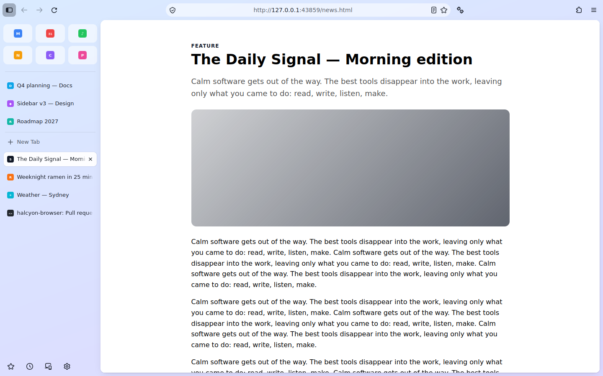

# Peryn

> Formerly worked on as Halcyon. The browser's name lives in one place, `project.toml`.

A fast, beautiful, private browser built on Firefox's Gecko engine, with an Arc-style layout,
built-in ad and tracker blocking, and zero telemetry.

**This is the user's browser, not ours.** Nothing runs, downloads or connects unless the user chose
it. See [docs/OWNERSHIP.md](docs/OWNERSHIP.md) for the eight release-blocking promises.

## Status

Phase 1 (Foundation) done: **C0 build pipeline**, **C1 privacy baseline**, **C2 Shield**.
Phase 2 (Core experience): **C3 Arc-style layout**, **C4 Spaces** and **C5 command bar** done,
checked in the official Firefox 158.0.1 (see below). Test installers are on the **test-build**
pre-release. C6 done (split view, Glance, welcome and import); C7 (Privacy Ledger) in progress.



| Area | State |
| --- | --- |
| `hx` toolchain | download Firefox, apply our changes, export edits, rebase, build, package |
| Upstream base | Firefox **158.0.1** Release |
| Privacy defaults | 119 prefs, every one verified against the Firefox source (or our own code) |
| Shield | uBlock Origin's default lists in Firefox's in-tree adblock-rust engine: network blocking and element hiding, ~11 µs per request. See [docs/SHIELD.md](docs/SHIELD.md) |
| Performance budgets | checked in CI: [docs/PERFORMANCE.md](docs/PERFORMANCE.md) |
| Layout | Arc-style: Essentials grid, Pinned and Today, centred address, page as a card, rail, compact mode (Ctrl+Alt+C). Built on Firefox's own vertical tabs with no patches. See [docs/LAYOUT.md](docs/LAYOUT.md) |
| Spaces | Named Spaces with their own colour, icon, Pinned tabs and optional container; switch by dot, swipe or Ctrl+Alt+arrows; synced with Firefox Sync. See [docs/SPACES.md](docs/SPACES.md) |
| Split view and Glance | Up to four panes (grid, one large plus two, stacked): drag a tab onto the page to split, drag the dividers; Alt+click a link to preview it in a card over the page. See [docs/SPLIT-AND-GLANCE.md](docs/SPLIT-AND-GLANCE.md) |
| Privacy Ledger | A local record of every connection the browser makes by itself (matched against the public list) and of what was blocked on each site; the privacy page with Strict/Balanced, exceptions, per-site permissions and clearing data; cookie pop-ups and nags hidden; a search engine and protection level per Space. See [docs/PRIVACY.md](docs/PRIVACY.md) |
| First run | A short welcome: import from any browser (Firefox's wizard), or from Arc or Zen (Spaces, pinned tabs, Favorites or Essentials), look, protection level, default browser asked once. See [docs/ONBOARDING.md](docs/ONBOARDING.md) |
| Command bar | Ctrl/Cmd+T and Ctrl/Cmd+L: tabs in every Space, bookmarks, history, actions and search in one box; a Rust index (WebAssembly) answers each keystroke in a few ms over 100,000 entries; custom keyboard shortcuts. See [docs/COMMANDBAR.md](docs/COMMANDBAR.md) |
| UI preview | CI loads our layout into stock Firefox 158.0.1, screenshots every state and checks behaviour in the real browser (`ui-previews` branch) |
| Compiled out | telemetry upload, Normandy experiments, crash reporter, Mozilla updater, Windows default-browser agent |
| Every-request registry | `privacy/requests.toml` → [docs/EVERY-REQUEST.md](docs/EVERY-REQUEST.md) |
| Network audit | CI launches the built browser and fails on any undocumented connection |
| Updates | notification-only update check against GitHub Releases; never auto-installs |
| Windows installer | `hx package` on Windows → `*.installer.exe` (built by the `build` workflow) |
| Patches to Firefox | 8 of a 60-file budget ([docs/PATCHES.md](docs/PATCHES.md)) |
| CI | tests on 3 OSes, upstream checks, Shield corpus and budgets, UI preview, twice-daily rebase bot; Windows and Linux builds, network audit, test-build pre-release, releases on `v*` tags |

## Get the browser

Download the Windows installer from the **test-build** pre-release on the Releases page (or
from the latest successful **build** run (Actions tab →
build → `windows-installer-dev`), or from **Releases** once a version is tagged. The build is not
code-signed yet, so Windows SmartScreen will warn: choose *More info → Run anyway*.

## Quick start

```sh
./hx doctor          # can this machine build? (16 GB RAM, ~40 GB disk recommended)
./hx download        # Firefox source -> engine/   (~3 GB, shallow)
python3 tools/omni/build_wasm.py   # the command bar's index (needs rustup's wasm32 target)
./hx import          # apply src/, branding, prefs, patches
./hx bootstrap       # Mozilla's toolchains (clang, rust, ...), once
./hx build --profile dev
./hx run
```

On Windows use `hx.cmd` from the MozillaBuild shell. Full guide: [docs/BUILDING.md](docs/BUILDING.md).

## Layout

| Path | What lives there |
| --- | --- |
| `project.toml` | Name, ids, Firefox version, patch budget — the single source of truth |
| `prefs/*.toml` | Default preferences, each with a reason; compiled into the build, never locked |
| `patches/` | One patch per upstream Firefox file we change (`patches/<path>.patch`) |
| `src/` | New files added to the Firefox tree (no budget cost); `*.tmpl` files get project values filled in |
| `src/browser/components/peryn/` | The browser's own components: layout (sidebar, compact mode), Spaces, command bar, split view, Glance, first-run welcome and Arc import, Shield, update notifier |
| `privacy/requests.toml` | Every connection the browser may make on its own; drives the public page and the audit |
| `crates/` | Rust: `omni-index` (the command bar's search, built to WebAssembly) and `shield-check` (Shield corpus and benchmarks against Firefox's engine) |
| `branding/overlay/` | Logo, icons and brand strings laid over Firefox's unofficial branding |
| `configs/` | mozconfig fragments: common + per-OS + per-profile (release / dev / artifact) |
| `tools/hx/` | The toolchain (Python 3.11+, standard library only) |
| `tools/preview/` | UI preview harness: our layout in stock Firefox under Xvfb, screenshots + checks |
| `engine/` | Downloaded Firefox source (git-ignored) |

## Everyday commands

| Command | Does |
| --- | --- |
| `hx status` | List edits in `engine/` not yet saved as patches |
| `hx export <file>` / `--all` | Save `engine/` edits to `patches/` (or `src/` for new files) |
| `hx import` | Reset `engine/` to upstream and re-apply everything |
| `hx audit-prefs --strict` | Check every default pref still exists upstream |
| `hx check-mozconfig` | Check every build option still exists upstream |
| `hx check-upstream` | Is a newer Firefox out? |
| `hx rebase [--to X]` | Move to a newer Firefox and re-apply everything |
| `hx patches` | Patched files vs the budget |
| `hx requests [--write]` | List the every-request registry / regenerate its page |

## License

[MPL 2.0](LICENSE), like Firefox. Not affiliated with or endorsed by Mozilla; "Firefox" is a
Mozilla trademark and is not used in this product's branding.
