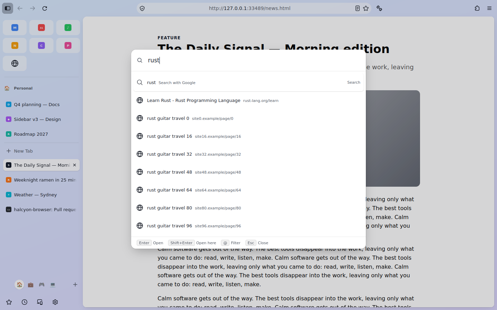

# The command bar

One box for everything: press **Ctrl+T** (Cmd+T on macOS) and type. It finds your open tabs in
every Space, your bookmarks, your history and the browser's actions, as fast as you can type,
and anything else becomes a web search or an address.



## Using it

| Press | Does |
| --- | --- |
| **Ctrl/Cmd+T** | Opens the bar. Enter opens the result in a new tab; Enter on an empty bar gives a blank tab, as before. |
| **Ctrl/Cmd+L** (or Alt+D) | Opens the bar on this page's address. Enter opens the result here. |
| **Shift+Enter** | The other one: here instead of a new tab, or a new tab instead of here. |
| **↑ ↓**, Ctrl+N / Ctrl+P | Move through the results. |
| **Esc** | Close (or drop the filter first). |
| **F6** | The real address bar, always. |

What you get, in order of how likely you meant it:

* **Open tabs** in any Space or window ("Switch to Tab"). Picking one takes you to its Space.
* **Actions**: New Space, Copy Link, Reader View, Clear Recent History, Zoom In and about thirty
  more, with their shortcuts shown. Words you might use work too: "bigger" finds Zoom In.
* **Spaces**, by name.
* **Bookmarks** and **history**, ranked by how often and how recently you visit them.
* **Search** with your default search engine (the private-window engine in private windows),
  or **Open** when what you typed is an address.

### Filters

Start with a filter to search one kind of thing. It turns into a chip; Backspace removes it.

| Type | Searches |
| --- | --- |
| `@tabs` | open tabs |
| `@bookmarks` | bookmarks |
| `@history` | history |
| `@actions` or `>` | actions and Spaces |
| `@spaces` | Spaces |

### Keyboard shortcuts

Search the bar for **Keyboard Shortcuts**. Every action is listed with its shortcut. Select one,
press Enter, then press the new shortcut. Backspace removes it; Esc cancels.

If Firefox already uses that shortcut (Ctrl+R for Reload, say), the editor says so and you press
it again to confirm. Firefox's shortcut is then switched off while yours exists, and comes back
when you remove yours. Shortcuts follow you to your other devices if you use Firefox Sync and
sync settings.

## Privacy

Everything the bar searches is already on your device, and stays there: the index lives in
memory in the browser and is never written anywhere or sent anywhere. The bar makes no network
requests of its own. Nothing is sent while you type (Firefox's search suggestions are not used);
a search goes to your search engine only when you press Enter on it. Private windows see only
private windows' tabs.

## How it works

| Piece | File |
| --- | --- |
| Search core: Rust, compiled to WebAssembly | `crates/omni-index/` → `omni_index.wasm` |
| JavaScript side of the index, and a fallback | `src/.../commandbar/OmniIndex.sys.mjs` |
| What gets indexed: Places, tabs, actions, Spaces | `HalcyonCommandIndex.sys.mjs` |
| The bar itself, Firefox's keys | `HalcyonCommandBar.sys.mjs`, `halcyon-commandbar.css` |
| Custom shortcuts | `HalcyonShortcuts.sys.mjs` |
| Rules (filters, ordering, shortcut parsing; unit-tested) | `HalcyonCommandLogic.sys.mjs` |

### The index

`omni-index` is a small Rust crate with no dependencies. It is compiled to WebAssembly so it
runs inside the browser's own JavaScript engine, sandboxed, with no native code to ship per
platform. The same code runs natively for tests and benchmarks.

Firefox treats compiling WebAssembly in its own privileged code like `eval()`, and allows it
only for files on a list (its developer tools are on it for the same reason). One patch adds
`OmniIndex.sys.mjs` to that list ([PATCHES.md](PATCHES.md)). If the module can't be compiled for
any reason, the bar falls back to a simple JavaScript index: still works, slower over a big
history.

For each item it keeps the lowercased title and address, a 64-bit "which characters occur" mask
and a 256-bit "which letter pairs occur" mask. A query:

1. Rejects most items with a few AND operations on those masks.
2. Scores the rest per word: the start of the title or site counts most, then the start of a
   word, then anywhere; the site's name beats the rest of the address. Loose matches ("ghub" for
   GitHub) count for less, and are only tried when exact matches are scarce.
3. Adds how useful the item is (Firefox's frecency, open tabs, bookmarks) and how recent.
4. Visits items most useful first and stops as soon as nothing left can make the top results.
   The data the filters need is stored contiguously in that order, so the scan reads memory in
   sequence.
5. While you type, each keystroke starts from the previous keystroke's candidates instead of
   from scratch.

New and changed items (a page you just visited) are searched in full until the next re-rank, so
they show up immediately. The bar asks for one search per frame however fast you type.

| Measured | Native (CI budget) | In Firefox's WebAssembly |
| --- | --- | --- |
| Build the index, 100,000 history entries | ~90 ms (600 ms) | checked by the UI preview |
| Per keystroke, 100,000 entries, p95 | ~2.5 ms (8 ms) | budget 16 ms, checked by the UI preview |

### History and bookmarks

Once the browser is idle after startup (or as soon as you first open the bar), the index loads
the 100,000 most-used history entries and all bookmarks from Firefox's database
(`halcyon.commandbar.historyLimit`), in chunks with breaks so the browser never stalls.
Places notifications keep it current: visits, new titles, removals, cleared history, bookmarks
added, removed or renamed. A full reload happens at most every 30 minutes, in the background; it updates entries in place,
so searching keeps working while it runs.

### Firefox's keys

The bar doesn't replace Firefox's keys; it points them at itself. `key_newNavigatorTab` (Ctrl+T)
and `focusURLBar` / `focusURLBar2` (Ctrl+L, Alt+D) lose their `command` while the bar is on, so
they fire their own command event, which the bar handles. Turning the bar off puts the original
commands back. Menus, the + New Tab button and the address bar are untouched.

## Settings (about:config for now)

| Pref | Default | Effect |
| --- | --- | --- |
| `halcyon.commandbar.enabled` | true | The whole command bar |
| `halcyon.commandbar.onNewTab` | true | Ctrl/Cmd+T opens the bar (false: Firefox's new tab) |
| `halcyon.commandbar.onAddressKey` | true | Ctrl/Cmd+L and Alt+D open the bar (false: the address bar) |
| `halcyon.commandbar.historyLimit` | 100000 | History entries searched (most used first) |
| `halcyon.shortcuts` | `{}` | Your shortcuts, as set in the editor |

## Building the index

The WebAssembly module is built from source before every import and never checked in:

```sh
rustup target add wasm32-unknown-unknown    # once
python3 tools/omni/build_wasm.py            # -> src/browser/components/halcyon/commandbar/omni_index.wasm
cd crates/omni-index && cargo test --release && cargo run --release --bin omni-bench
```

`hx import` stops with that hint if the module is missing. On Windows, run it from a normal
shell (PowerShell) with Rust installed from rustup.rs.

## Not done yet

| Item | Plan |
| --- | --- |
| Search suggestions from the engine | Off on purpose (they send every keystroke); may come as an opt-in |
| Settings pages as results ("cookies" → the right settings section) | With the settings redesign |
| Localised strings | With the browser's own localisation files |
| "+ New Tab" button opening the bar | Under consideration; Ctrl/Cmd+T already does |
