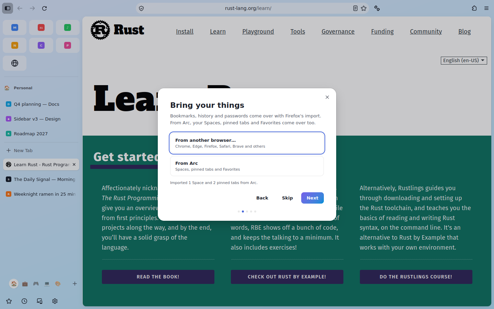

# First run and import

The first time Peryn opens, a short welcome sits over the window. Every step can be skipped,
Esc closes it, and it never shows itself again; the command bar's **Welcome and Import** brings
it back. It sends nothing anywhere.

1. **Welcome.**
2. **Bring your things.**
   - *From another browser*: Firefox's own import wizard (Chrome, Edge, Firefox, Safari,
     Brave, Opera, Vivaldi and others): bookmarks, history, passwords, payment methods.
   - *From Arc*: your Spaces (with their emoji and colours), pinned tabs and Favorites. Peryn
     finds Arc's sidebar file where Arc keeps it on macOS and Windows, or asks you to pick
     `StorableSidebar.json`. Favorites become Essentials. Folders are flattened, since Peryn
     doesn't have folders yet. Today's unpinned tabs aren't imported (Arc archives them anyway).
     Imported tabs don't load anything until you open them.
   - *From Zen*: your Spaces (with their emoji and colours), pinned tabs and Essentials, read
     from Zen's session file (`zen-sessions.jsonlz4`, or `sessionstore.jsonlz4` before Zen
     1.18) in its most recently used profile. Quit Zen first, since it rewrites the file on
     exit. Zen's own SVG icons don't carry over, only emoji. For Zen's bookmarks, export them
     to an HTML file in Zen and import that file through Firefox's wizard.
3. **Pick a look**: match the system, light or dark (Firefox's built-in themes).
4. **Protection**: *Strict* (what Peryn ships) or *Balanced* (Firefox's standard protection,
   for fewer broken sites). Ad blocking is on either way. This sets Firefox's own
   Enhanced Tracking Protection category, so Settings shows the same choice.
5. **Default browser**: asked here once, and never again (Firefox's own reminder is off).

## Importing from Arc or Zen later

Command bar > **Import from Arc** or **Import from Zen**. On a fresh profile, the imported
Spaces replace the empty "Personal" Space; otherwise they're added after yours, and a name you
already use gets "(Arc)" or "(Zen)" after it. Essentials you already have aren't doubled. The usual limits apply
(24 Spaces, 200 pinned tabs per Space); anything left out is counted in the message.

Neither Arc's nor Zen's file format is documented, and both have changed over time, so the
importers read them defensively and skips anything it doesn't recognise. If an import misses something, open an
issue with the shape of the file (not its contents).

Code: `src/browser/components/peryn/onboarding/`. `PerynArcImport.sys.mjs` and
`PerynZenImport.sys.mjs` are the parsers, with the shared merge in the first (unit-tested); `PerynOnboarding.sys.mjs` is the welcome itself.
