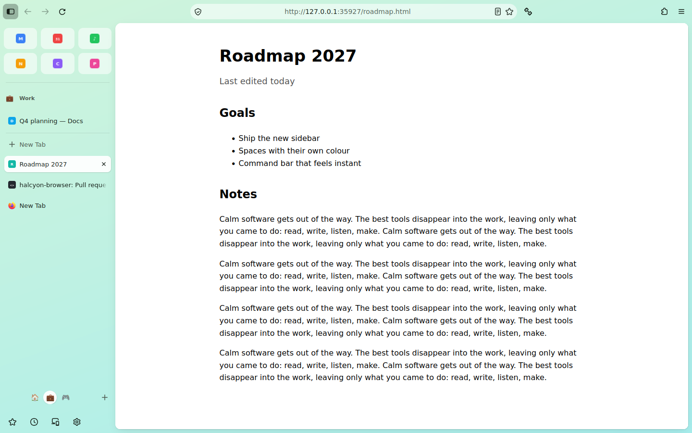
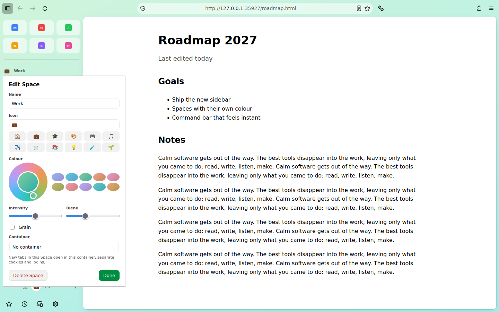

# Spaces

A Space is a named set of tabs with its own colour, its own Pinned tabs and, if you like, its
own container. Work, Personal, a project: each gets a Space, and switching is instant.

## Using Spaces

| To | Do |
| --- | --- |
| Switch Space | Click a dot at the bottom of the sidebar, swipe sideways on the sidebar, or **Ctrl+Alt+←/→** (Cmd+Option on macOS). **Ctrl+Alt+1…9** jumps straight to a Space. |
| Make a Space | The **+** next to the dots. The editor opens so you can name it. |
| Edit a Space | Click its name above the Pinned tabs, or right-click its dot. |
| Move tabs to another Space | Right-click a tab > **Move to Space**. Moving the tab you're on takes you with it. |
| Delete a Space | In the editor, **Delete Space**, then click again to confirm. Its tabs move to the Space before it. |

What belongs where:

* **Essentials** (the tiles at the top) are shared by every Space.
* **Pinned tabs and Today tabs** belong to one Space. Switching shows that Space's tabs and goes
  back to the tab you used last there.
* Closing a Space's last tab gives you a fresh tab in the same Space.
* **Private windows** don't have Spaces.

## The editor

| Setting | Effect |
| --- | --- |
| Name and icon | Shown above the Pinned tabs and on the Space's dot. Any emoji or letter works. |
| Colour | Pick a hue on the wheel or a preset. The whole window takes it on: backdrop, top bar and sidebar, in light and dark mode. |
| Intensity | How strong the colour is. |
| Blend | How far the gradient's second colour moves around the wheel from the first. |
| Grain | A subtle film-grain texture over the backdrop. |
| Container | New tabs in this Space open in that container, with separate cookies and logins (a Work account here, a personal one elsewhere). Pick an existing container, or let the Space make one with its name. |

## Sync

When you sign in to a Mozilla account and keep **Settings** syncing, your Spaces (names, icons,
colours, containers), Pinned tabs and Essentials appear on your other devices, end-to-end
encrypted like the rest of Firefox Sync. On another device:

* a synced Pinned tab or Essential that isn't open there yet opens unloaded (it loads when you
  click it), in the most recently used window;
* one you unpin or close elsewhere stops being pinned here; the tab itself stays open;
* containers are matched by name, and created on that device if they don't exist yet.

**The first time a second device syncs, it takes the Spaces already in your account.** Its own
Spaces are replaced, its tabs move into the first Space, and any of its pinned tabs that aren't
in the account are unpinned (they stay open). Edits made on two devices at the same moment: the
later one wins.

Under the hood the data is one preference, `halcyon.spaces`, which Firefox Sync's preferences
engine carries because `services.sync.prefs.sync.halcyon.spaces` is on. Turn that off to keep
Spaces on this device only.

## How it's built

| Piece | File (in `src/browser/components/halcyon/spaces/`) |
| --- | --- |
| Data model: validation, edits, colours, launcher reconciliation (pure, unit-tested) | `HalcyonSpacesLogic.sys.mjs` |
| The shared copy, saved in the synced pref; containers | `HalcyonSpacesStore.sys.mjs` |
| One window: membership, switching, new tabs, shortcuts, swipe, launchers | `HalcyonSpaces.sys.mjs` |
| Space name, switcher, editor, Move to Space | `HalcyonSpacesUI.sys.mjs` |
| Styling and the switch animation | `halcyon-spaces.css` |

Hiding other Spaces' tabs uses Firefox's own tab hiding (the mechanism tab-group extensions
use), so hidden tabs keep running, stay in session restore, and come back without reloading.
Like the rest of the layout, Spaces cost **no patches to Firefox's files**.

## How it's checked

* 19 unit tests on the data model, the store and a window controller against a fake tab strip.
* The UI preview runs Spaces in the official Firefox 158.0.1 and checks: only the active Space's
  tabs show; its name, colour and Pinned launcher; Ctrl+Alt+→ and Ctrl+Alt+1; closing a Space's
  last tab; and another device's changes arriving the way Firefox Sync applies them (a new Space
  and a new Essential appear, the Essential opening unloaded).

A real two-account Sync round trip needs a signed-in build, so it is next on the list now that
installers are being built.
