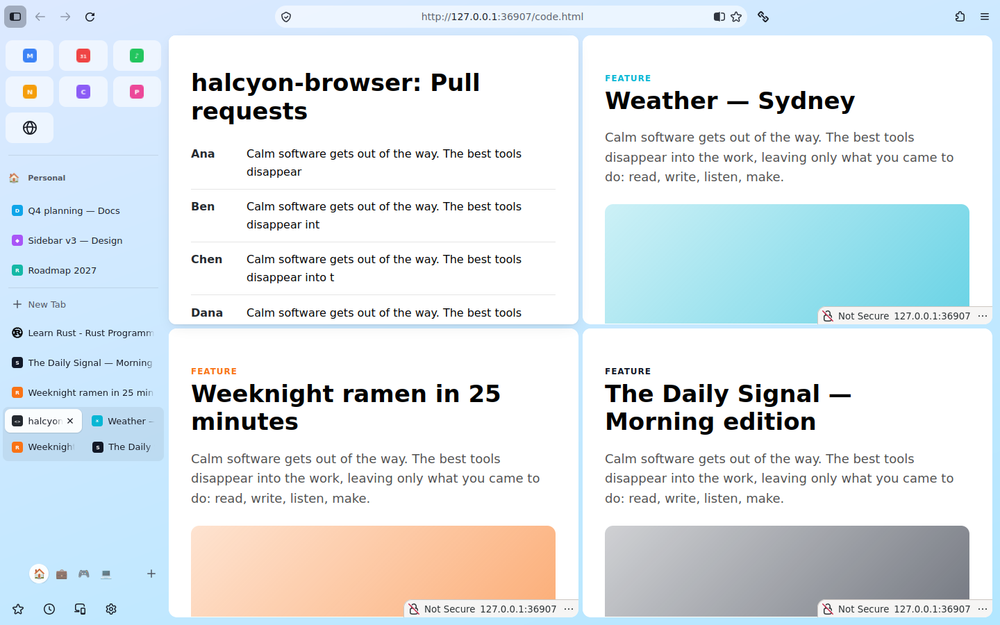
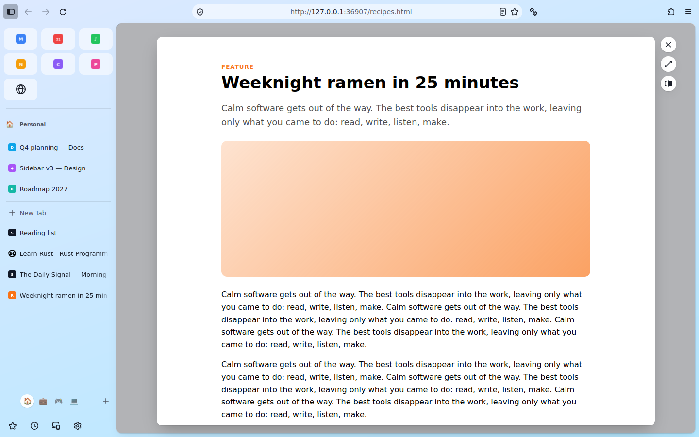

# Split view and Glance

Two ways to look at more than one page without losing your place. Both arrived in C6.

## Split view: up to four panes

Firefox 158 has its own split view for two pages side by side. Peryn keeps that as it is and
adds a third and fourth pane and other arrangements on top of it.

| Panes | Layouts (the first is the default) |
| --- | --- |
| 2 | Side by side (Firefox's own), Stacked |
| 3 | One large and two small, Side by side, Stacked |
| 4 | Grid, Side by side, Stacked |

- **Start one**: select two tabs and use Firefox's *Add Split View*, or the command bar's
  *Split View* action.
- **Add a pane**: right-click a tab > *Add to Split View*, or the command bar's *Add Tab to
  Split View*, which opens a tab picker.
- **Change the layout**: command bar > *Change Split View Layout* cycles through the layouts.
- **Resize**: drag the thin handle between panes (it shows on hover), or focus it and use the
  arrow keys. Panes stay between 20% and 80%.
- **Close a pane**: close its tab; the others stay split. *Separate Split View* ends it.

Panes glide to their new places when one is added or closed, or the layout changes.

The layout and divider positions are saved with the split, so they come back after a restart.

How it works: Firefox groups the tabs in a split view and shows their panels; Peryn marks each
panel with a grid area and lays the content area out as a CSS grid
(`src/browser/components/peryn/split/`). No Firefox source is patched.

## Glance: preview a link without leaving the page

**Alt+click** (Option+click on macOS) a link and it opens in a card floating over the page
you're on. The page underneath stays on screen and keeps running.

- **Esc**, the **x** button or a click beside the card closes it, back to where you were.
- **Open as a tab** (or the command bar's *Keep Preview as a Tab*) keeps it as an ordinary tab
  right after the page.
- **Open side by side** (or *Open Preview Side by Side*) puts the page and the preview in a
  split view; if the page is already in one, the preview joins it.
- Switching to any other tab keeps the preview as an ordinary tab, so nothing is lost.
- Alt+clicking a link inside a preview replaces it, over the same page.

A preview is an ordinary tab under the hood (same container, same protections), hidden from the
sidebar while it's a preview. To turn Glance off, set `peryn.glance.enabled` to `false` in
about:config; Alt+click then does what it does in Firefox.

Code: `src/browser/components/peryn/glance/`. The page side is a small window actor that only
listens for Alt+click on http(s) links and for Esc. It runs in ordinary web content processes,
which Firefox allows only for actors marked `safeForUntrustedWebProcess`; the browser side
therefore trusts nothing from it beyond a plain http(s) URL, opened with the page's own
permissions as a preview of the tab on screen.
